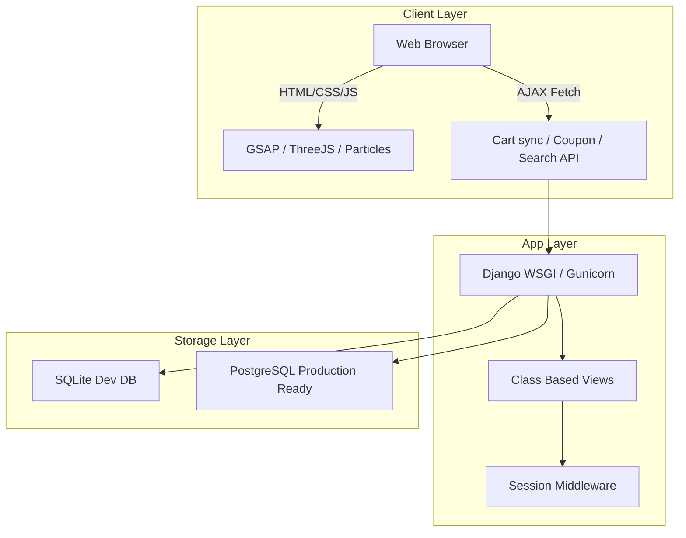
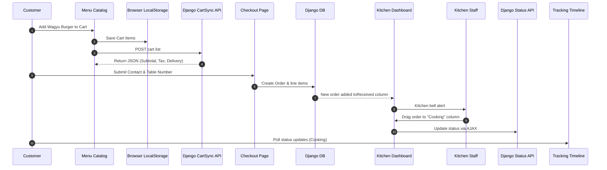

# Smart Restaurant Ordering & Kitchen Dashboard

L'Étoile Bistro is an enterprise-grade contactless restaurant management ecosystem. Built on **Django 5** and Python 3.11, it combines a premium customer ordering catalog with a live-polling kitchen pipeline and SaaS analytics reporting views.

The application features a sleek dark-themed **Glassmorphic** UI styled with Bootstrap 5.3, GSAP micro-animations, Particles.js backdrop, and Three.js 3D floating wireframe models.

---

## Technical Architecture



---

## Database ER Diagram

```mermaid
erDiagram
    Category ||--o{ MenuItem : contains
    Customer ||--o{ Order : places
    Order ||--o{ OrderItem : details
    MenuItem ||--o{ OrderItem : ordered_in
    MenuItem ||--o{ Review : reviewed
    Order ||--|| Payment : billing
    Order ||--o[ Coupon : applied
```

---

## Application Flow



---

## Core System Features

1. **Elegant Glassmorphism Theme**: Curated Slate-dark palette with translucent panels, rounded contours, and smooth mouse-tilt responsive vectors.
2. **Dynamic Menu Search & Filtering**: Instant search entries, diet filter switches (Veg, Spicy), and sorted catalog grids without reload.
3. **JS LocalStorage Cart Sync**: Client-side storage synchronized instantly with Django sessions.
4. **Interactive Kitchen board**: 3-column kanban board supporting native drag-drop status updates and custom priority order shifting.
5. **PDF Invoicing**: In-memory PDF compiling of client orders powered by reportlab.
6. **Analytics charts**: SaaS home reporting charts built with Chart.js.

---

## Installation & Setup Guide

### Prerequisites
- Python 3.11+
- Git

### Local Setup Steps
1. **Clone & Navigate**:
   ```bash
   cd PROJECT
   ```
2. **Virtual Environment**:
   ```bash
   python -m venv venv
   # On Windows:
   venv\Scripts\activate
   # On macOS/Linux:
   source venv/bin/activate
   ```
3. **Dependencies**:
   ```bash
   pip install -r requirements.txt
   ```
4. **Environment Configuration**:
   Create a `.env` file in the root based on `.env.example`:
   ```ini
   DEBUG=True
   SECRET_KEY=django-insecure-key-for-development
   ```
5. **Database Migration**:
   ```bash
   python manage.py makemigrations core
   python manage.py migrate
   ```
6. **Seed Premium Data**:
   Prepopulate dishes, categories, coupons, and contacts:
   ```bash
   python manage.py seed_data
   ```
7. **Start Dev Server**:
   ```bash
   python manage.py runserver
   ```
   Open `http://127.0.0.1:8000/` to explore L'Étoile.

---

## Deployment Manual (Render.com)

1. **Deploy Repository**: Push code to GitHub/GitLab.
2. **Create Render Web Service**:
   - Environment: `Python`
   - Build Command: `pip install -r requirements.txt && python manage.py collectstatic --no-input && python manage.py migrate`
   - Start Command: `gunicorn config.wsgi:application`
3. **Configure Variables**:
   - `DEBUG`: `False`
   - `SECRET_KEY`: (Generate secure key)
   - `DATABASE_URL`: Add target PostgreSQL connection string for production.
